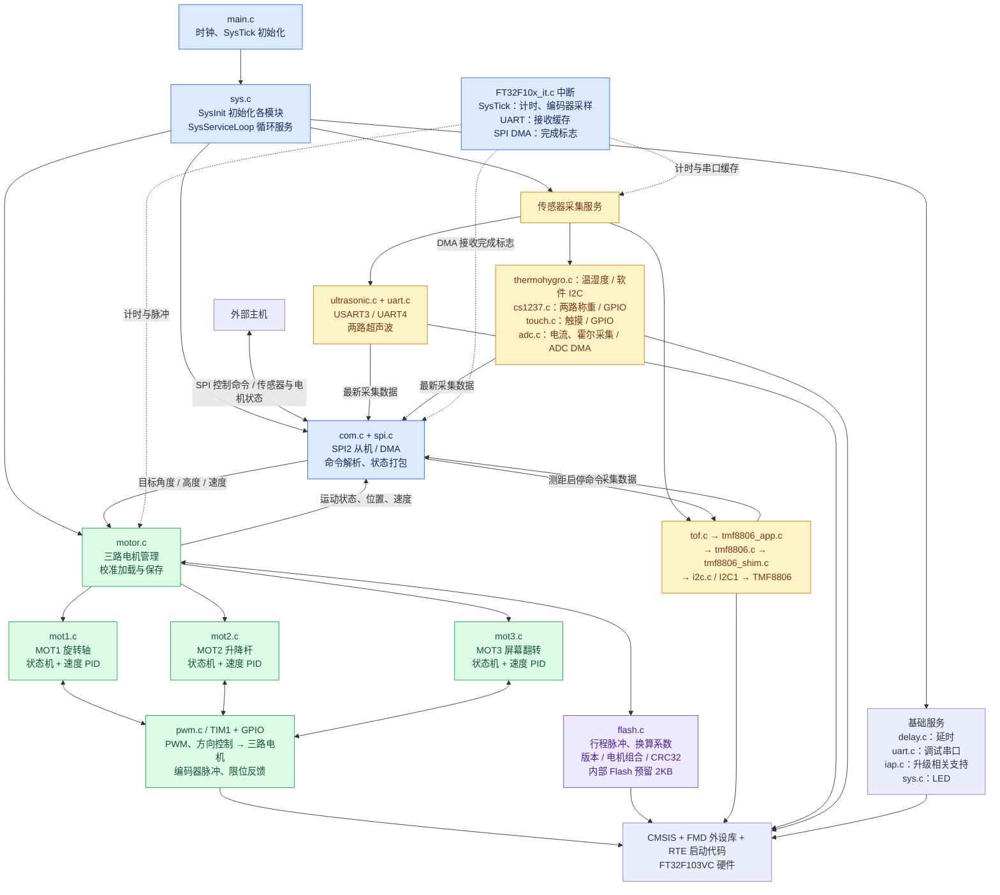
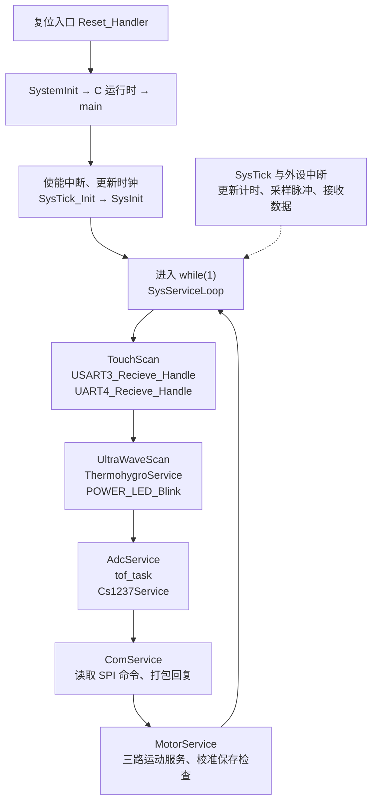
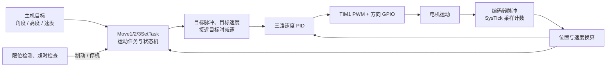
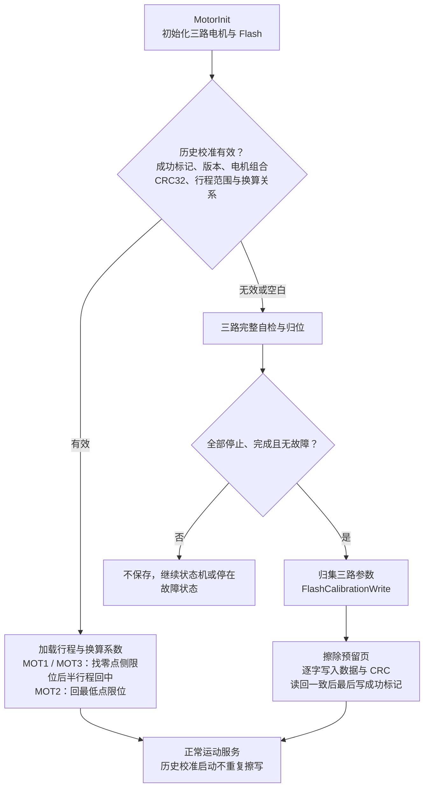

# FT32F103 V7 工程框架图

依据 2026-10-10 当前工作区源码绘制。芯片为 FT32F103VC，采用主循环轮询和中断配合的裸机结构。

## 整体模块关系

实线表示主要调用或数据流；虚线表示中断提供的计时、采样或完成标志。

`ComService()` 实际直接调用 `Move1SetTask()`、`Move2SetTask()`、`Move3SetTask()`；总图将它们归入电机管理这一功能范围。模块通过全局状态结构和完成标志共享数据，图中的箭头不代表消息队列。

## 实际运行顺序

各模块在自己的服务函数内根据计时值、状态机或完成标志决定是否执行工作。三路速度 PID 的周期门限由 `C_PID_RATE = 50` 定义，计时由 SysTick 更新，PID 运算在电机服务中执行。

## 电机闭环与校准

PWM 通道对应关系：MOT1 旋转轴使用 TIM1 CH3；MOT2 升降杆使用 TIM1 CH1；MOT3 屏幕翻转使用 TIM1 CH2。

校准记录共 36 字节，位于 `0x0803F800` 开始的末尾 2KB 页；`robot_calibration.sct` 将程序区限制为 `0x3F800` 字节。当前校准记录保存行程与换算系数，归位仍先寻找限位基准。

## 源码核对入口

| 内容 | 文件与入口 |
| --- | --- |
| 复位启动 | `RTE/Device/FT32F103VC/startup_FT32F10x_hd.s`：`Reset_Handler` |
| 主程序 | `USER/Sourse/main.c`：`main` |
| 初始化与循环调度 | `USER/Sourse/sys.c`：`SysInit`、`SysServiceLoop` |
| 中断协作 | `USER/Sourse/FT32F10x_it.c`：SysTick、UART、DMA 中断 |
| 主机通信 | `USER/Sourse/com.c`、`USER/Sourse/spi.c` |
| 电机与 PID | `USER/Sourse/motor.c`、`mot1.c`、`mot2.c`、`mot3.c`、`pwm.c` |
| 校准存储 | `USER/Sourse/flash.c`、`USER/Include/flash.h`、`robot_calibration.sct` |
| ToF 驱动链 | `tof.c`、`tmf8806_app.c`、`tmf8806.c`、`tmf8806_shim.c`、`i2c.c` |
| 其他采集 | `ultrasonic.c`、`thermohygro.c`、`cs1237.c`、`touch.c`、`adc.c` |

ToF 当前通过 I2C 轮询获取结果，`USE_INTERRUPT_TO_TRIGGER_READ = 0`；当前定义 `USE_ROM_FIRMWARE`，启动使用 TMF8806 内置 ROM 应用，未走 `tmf8806_image.c` 的 RAM 固件下载分支。
